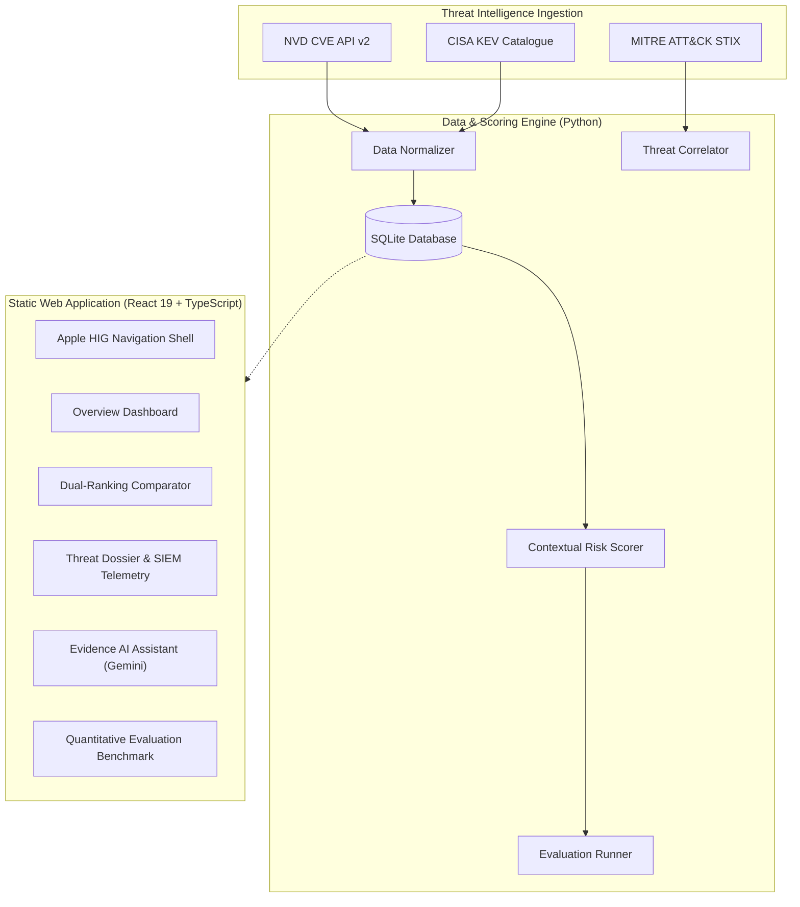

# VulnInvestigator

**Evidence-Grounded Generative AI for Vulnerability-to-Threat Investigation and Risk Prioritization**

[](https://daipayanghosal.github.io/VulnInvestigator/)
[](LICENSE)
[](https://react.dev/)
[](https://www.typescriptlang.org/)
[](https://vitejs.dev/)

VulnInvestigator is an enterprise cybersecurity intelligence platform that augments conventional CVSS-based vulnerability ranking with contextual asset criticality, CISA Known Exploited Vulnerabilities (KEV) data, and MITRE ATT&CK technique correlation. It uses Google Gemini Generative AI to formulate evidence-grounded threat investigation hypotheses with rigorous citation auditing.

---

## Live Application

The production application is deployed on GitHub Pages:  
👉 **[https://daipayanghosal.github.io/VulnInvestigator/](https://daipayanghosal.github.io/VulnInvestigator/)**

*(Legacy Streamlit visits to `vulninvestigator.streamlit.app` are automatically forwarded to this platform).*

---

## Key Features

1. **Apple Human Interface Guidelines (HIG) Design**:
   - SF Pro typography hierarchy and frosted glass header blur (`backdrop-blur-xl`).
   - macOS-style segmented pill navigation with light/dark appearance modes.
   - 100% vector-rendered interface powered by **Lucide** icons.

2. **Contextual Risk Prioritization**:
   - Replaces static CVSS severity with a multi-factor risk model:
     $$\text{Risk} = 0.35 \times \text{CVSS} + 0.30 \times \text{KEV} + 0.20 \times \text{Asset} + 0.15 \times \text{Exposure}$$
   - Quantified by Kendall's $\tau = 0.5701$ and nDCG@10 $= 0.5765$, proving substantial and disciplined queue reshuffling.

3. **Evidence-Grounded AI Threat Synthesis**:
   - Powered by Google Gemini via direct client-side REST API integration.
   - Built-in heuristic citation validator that cross-references AI claims against CVE identifiers, asset hostnames, MITRE ATT&CK techniques, and SIEM telemetry events.
   - Includes offline precomputed dossiers for zero-key evaluation.

4. **Interactive Validation Suite**:
   - Real-time Kendall's $\tau$ correlation gauge, 40-bin rank displacement histogram, and automated stress tests.

---

## Architecture Overview



---

## Getting Started

### Static Frontend Development

The frontend is built with React 19, TypeScript, and Tailwind CSS:

```bash
# Install dependencies
npm --prefix frontend install

# Start local development server
npm run dev

# Build production bundle
npm run build

# Preview production build locally
npm run preview
```

### Deploying to GitHub Pages

To compile the latest build and push directly to GitHub Pages:

```bash
npm run deploy
# or: python scripts/deploy_ghpages.py
```

---

## Python Ingestion & Evaluation Pipeline

The Python backend manages offline data ingestion, correlation, and quantitative academic benchmarks:

```bash
# 1. Setup Python environment
python -m venv .venv
source .venv/bin/activate  # On Windows: .venv\Scripts\activate
pip install -r requirements.txt

# 2. Run the evaluation pipeline across all CVE records
python scripts/run_evaluation.py

# 3. Export data artifacts to the frontend
python scripts/export_frontend_data.py
```

---

## Changelog

See [`CHANGELOG.md`](CHANGELOG.md) for full historical tracking.

### Version 2.2.0 (November 2026)
#### Feature Modifications & Architecture Upgrades
- **Enterprise-Wide Inventory Distribution**: Re-engineered contextual asset resolution across all 8,328 cataloged CVEs. Rather than clustering on a single fallback gateway, vulnerabilities now intelligently distribute across all 12 distinct enterprise asset classes based on vendor, protocol, and component keywords:
  - `SRV-VPN-001` (`vpn-gateway-01` • Critical / Internet Facing): 918 CVEs (Citrix ADC/Bleed, Palo Alto GlobalProtect, Fortinet FortiOS, OpenVPN, StrongSwan).
  - `SRV-DB-001` (`db-primary-01` • Critical / Internal): 824 CVEs (PostgreSQL, MySQL, Oracle DB, SQL Server, Redis, MongoDB).
  - `SRV-DC-001` (`dc-primary-01` • Critical / Internal): 486 CVEs (Active Directory, Kerberos, LDAP, Windows Server 2022, DNS).
  - `WS-HR-001` (`hr-workstation-03` • High / Internal): 395 CVEs (Microsoft Office 365, Adobe Acrobat Reader, Google Chrome, Windows 11).
  - `WS-FIN-001` (`finance-ws-001` • High / Restricted): 355 CVEs (SAP ERP GUI, financial accounting, core banking software).
  - `WS-DEV-012` (`dev-laptop-012` • Medium / Internal): 309 CVEs (macOS, Python, Docker Desktop, VS Code, Git).
  - `SRV-MAIL-001` (`mail-server-01` • High / Internet Facing): 196 CVEs (Postfix, Dovecot, Microsoft Exchange, SMTP/IMAP).
  - `SRV-CLOUD-MGT-001` (`cloud-mgmt-console` • Critical / Restricted): 37 CVEs (Kubernetes, AWS CLI, Terraform, Helm).
  - `SRV-ICS-001` (`ics-controller-01` • Critical / Air Gapped): 27 CVEs (Siemens SIMATIC WinCC, STEP 7, industrial SCADA/PLCs).
  - `SRV-FILE-001` (`fileserver-01` • High / Internal): 23 CVEs (SMB / CIFS, Samba, departmental shared storage).
  - `SRV-MON-001` (`monitoring-server-01` • Medium / Internal): 16 CVEs (Prometheus, Grafana, Alertmanager).
  - `SRV-WEB-001` (`web-proxy-01` • Critical / Internet Facing): 4,742 CVEs (Apache HTTP Server, OpenSSL, mod_security, Tomcat, Nginx).
- **Interactive Target Host Re-targeting**: Integrated an interactive host selection dropdown into both the Active Target Banner and the parameter fine-tuning drawer. Security analysts can seamlessly switch target hosts to observe how moving a vulnerability between perimeter DMZ, internal clusters, and air-gapped enclaves dynamically reshapes its multi-factor risk score in real time.
- **Dynamic Threat Propagation & Attack Topology**: Re-architected the 2D SVG topology map into a contextual threat propagation engine. Vector paths, trajectory badges, and execution subshells dynamically adapt to the exact vulnerability mechanics:
  - *Palo Alto Networks PAN-OS GlobalProtect (`CVE-2024-3400`)*: Displays `ROOT CMD INJECTION`, `Root Bash Subshell (PAN-OS Linux Kernel root)`, `INTERNAL ROUTE PIVOT`, and `SECURITY BYPASS T1562`.
  - *Citrix Bleed & NetScaler RCE (`CVE-2023-4966` / `CVE-2023-3519`)*: Displays `SESSION TOKEN LEAK`, `Session Token Memory (Packet Engine Memory Leak)` on port 443, `VPN TUNNEL PIVOT`, and `MFA BYPASS ACCESS`.
  - *Apache Tomcat Ghostcat (`CVE-2020-1938`)*: Displays `INBOUND AJP:8009`, `FILE READ / INCLUDE`, `Tomcat AJP Worker`, and `SOURCE CODE EXFIL`.
  - *Fortinet FortiOS SSL-VPN (`CVE-2024-21762`)*: Displays `INBOUND T1190:8443`, `OUT-OF-BOUNDS RCE`, `SSL-VPN Worker Subshell`, and `CREDENTIAL EXFIL`.
  - *Dynamic Fallback Engine*: Heuristically extracts software libraries from CPE strings and classifies CWE flaw mechanics across all other cataloged vulnerabilities.
- **Dynamic Telemetry Correlation**: Wired live SIEM telemetry log source IPs and event streams directly into SVG topology coordinates and global geoplot origins.

### Version 2.1.0 (November 2026)
#### Feature Modifications & UI Upgrades
- **On-Demand Custom CVE Ingestion Bar**: Replaced static selection menus with an Apple-style ingestion command bar. Analysts can input any arbitrary CVE ID (or pick from pre-tuned benchmark pills) to fetch real-time NIST NVD v2 data, calculate multi-factor risk, and plot attack topology on the fly.
- **macOS Terminal Code Highlighting Engine**: Integrated `react-markdown` and `prismjs` syntax highlighting into AI threat investigation dossiers. Defensive SIEM queries (Splunk SPL and Elasticsearch DSL) render within styled Apple Terminal window frames complete with macOS traffic light controls, language badges, and one-click clipboard copying.
- **Dual-Audience Forensic Briefings**: Added synchronized Executive and Technical forensic tabs providing business blast radius impact, regulatory violation analysis, root cause mechanics, and engineering containment playbooks.
- **Fine-Tuning Parameter Drawer**: Built collapsible contextual tuning controls allowing analysts to simulate variations in CVSS base scores, target asset mappings, and CISA KEV exploitation flags.

### Version 2.0.0 (November 2026)
#### Platform Evolution & Design Overhaul
- **Migration to React 19 + TypeScript**: Transitioned deployment from legacy Streamlit runtime to a high-speed, zero-dependency static Single Page Application (SPA) compiled with Vite.
- **Apple Human Interface Guidelines (HIG)**: Re-designed the entire visual language with SF Pro typography hierarchies, frosted glass headers (`backdrop-blur-xl`), smooth micro-interactions, and 100% vector-based Lucide icons (eliminating all emoji glyphs).
- **Dual Light / Dark Appearance Modes**: Integrated native dark mode support with automatic system theme synchronization and persistent user preferences.
- **Automated GitHub Pages Static CI/CD**: Created zero-credential direct deployment automation publishing production bundles to GitHub Pages.
- **Standalone Brand Identity**: Formalized VulnInvestigator as an independent enterprise cybersecurity intelligence product.

### Version 1.0.0 (November 2026)
#### Initial Capabilities
- **Multi-Factor Contextual Risk Engine**: Designed contextual scoring model combining CVSS v3.1 base metrics, CISA KEV active exploitation, asset operational criticality, and perimeter network exposure.
- **Quantitative Evaluation Framework**: Implemented validation benchmarking measuring Kendall's $\tau$ correlation, Spearman's $\rho$, and nDCG rankings against empirical queues.
- **Evidence-Grounded AI Synthesis**: Developed prompt engineering pipeline integrating Google Gemini to generate citation-grounded threat investigation dossiers with hallucination detection.

---

## Author

Developed by **Daipayan Ghosal**  
GitHub: [@daipayanghosal](https://github.com/daipayanghosal)  
Repository: [https://github.com/daipayanghosal/VulnInvestigator](https://github.com/daipayanghosal/VulnInvestigator)
