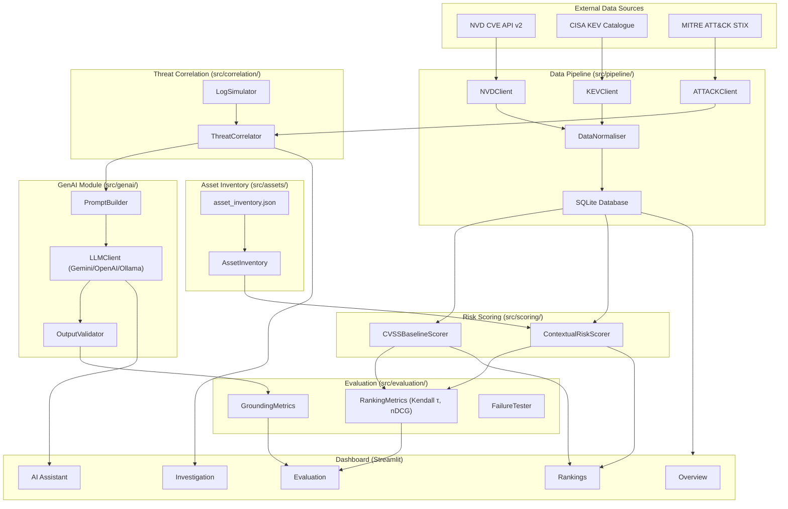

# VulnInvestigator 🔍

**Evidence-Grounded GenAI for Vulnerability-to-Threat Investigation and Risk Prioritisation**

A cybersecurity research prototype that augments conventional CVSS-based vulnerability ranking with contextual asset risk, CISA KEV exploitation data, and MITRE ATT&CK technique correlation — then uses a large language model to generate evidence-grounded investigation reports with citation validation.

---

## Architecture



---

## Quickstart

```bash
# 1. Clone the repository
git clone <repo-url>
cd Project

# 2. Create and activate a virtual environment
python -m venv .venv
# Windows:
.venv\Scripts\activate
# macOS/Linux:
source .venv/bin/activate

# 3. Install dependencies
pip install -r requirements.txt

# 4. Configure environment
cp .env.example .env
# Edit .env and add your GEMINI_API_KEY (or other backend credentials)

# 5. Run the data pipeline (fetches NVD, KEV, ATT&CK — takes ~5–10 min)
python scripts/run_pipeline.py

# 6. Launch the Streamlit dashboard
streamlit run src/dashboard/app.py
```

---

## Project Structure

```
Project/
├── config/
│   ├── settings.yaml          # Main application configuration
│   └── scoring.yaml           # Risk scoring weights and tier definitions
├── data/
│   ├── assets/
│   │   └── asset_inventory.json   # Simulated organisation asset inventory
│   ├── logs/
│   │   └── README.md              # Log event format documentation
│   ├── raw/                       # Raw API responses (git-ignored)
│   └── processed/                 # Parquet + SQLite outputs (git-ignored)
├── docs/
│   ├── data_dictionary.md         # Schema documentation for all data structures
│   └── decisions/
│       └── ADR-001-llm-backend.md # Architecture decision record
├── notebooks/
│   └── 01_data_exploration.ipynb  # Exploratory data analysis
├── scripts/
│   ├── run_pipeline.py            # Pipeline entry point
│   └── run_evaluation.py          # Evaluation entry point
├── src/
│   ├── assets/
│   │   └── inventory.py           # Asset inventory loader and query interface
│   ├── correlation/
│   │   └── correlator.py          # CVE → ATT&CK technique mapping
│   ├── dashboard/
│   │   ├── app.py                 # Streamlit main app
│   │   └── pages/                 # Dashboard page modules
│   ├── evaluation/
│   │   ├── ranking_metrics.py     # Kendall τ, rank displacement, nDCG
│   │   ├── grounding_metrics.py   # Evidence citation and hallucination metrics
│   │   └── failure_tester.py      # Automated failure-mode tests
│   ├── genai/
│   │   ├── llm_client.py          # LLM backends (Gemini, OpenAI, Ollama)
│   │   ├── prompt_builder.py      # Structured prompt construction
│   │   └── output_validator.py    # Evidence-grounding validation
│   ├── logs/
│   │   └── simulator.py           # SIEM log event simulator
│   ├── pipeline/
│   │   ├── nvd_client.py          # NVD CVE API client
│   │   ├── kev_client.py          # CISA KEV client
│   │   ├── attack_client.py       # MITRE ATT&CK client
│   │   ├── normaliser.py          # Data normalisation and merging
│   │   └── database.py            # SQLite persistence layer
│   └── scoring/
│       ├── baseline.py            # CVSS-only baseline scorer
│       └── contextual.py          # Multi-factor contextual risk scorer
├── tests/
│   ├── test_scoring.py
│   ├── test_pipeline.py
│   ├── test_evaluation.py
│   └── test_genai.py
├── .env.example                   # Environment variable template
├── .gitignore
├── requirements.txt
└── README.md
```

---

## Configuration

### `config/settings.yaml`

| Key | Description |
|---|---|
| `llm.backend` | LLM backend: `gemini` / `openai` / `ollama` |
| `llm.model` | Model name, e.g. `gemini-2.0-flash` |
| `llm.temperature` | Sampling temperature (default: 0.2) |
| `pipeline.nvd_base_url` | NVD API v2 endpoint |
| `pipeline.request_delay_seconds` | Delay between NVD API calls (rate-limit compliance) |
| `data.db_path` | SQLite database path |

### `config/scoring.yaml`

The contextual risk formula:

$$\text{score} = w_{\text{cvss}} \cdot \frac{\text{CVSS}}{10} + w_{\text{kev}} \cdot \text{KEV} + w_{\text{asset}} \cdot \text{criticality} + w_{\text{exp}} \cdot \text{exposure}$$

Default weights: CVSS=0.35, KEV=0.30, Asset=0.20, Exposure=0.15

---

## Running the Data Pipeline

```bash
# Fetch all CVEs from the last 90 days
python scripts/run_pipeline.py

# Fetch CVEs matching a keyword
python scripts/run_pipeline.py --keyword "Apache" --days 30

# The pipeline:
# 1. Fetches NVD, KEV, ATT&CK
# 2. Normalises and merges datasets
# 3. Applies contextual risk scoring
# 4. Saves to SQLite + prints Rich summary table
```

---

## Running Evaluation

```bash
python scripts/run_evaluation.py

# Outputs:
# - Kendall's τ between CVSS and contextual rankings
# - nDCG@10, nDCG@20
# - Rank displacement table (top 20 movers)
# - data/processed/evaluation_results.json
```

---

## Running Tests

```bash
# Run all tests with coverage
pytest tests/ --cov=src --cov-report=term-missing

# Run a specific test file
pytest tests/test_scoring.py -v

# Tests run without API keys (all LLM calls are mocked)
```

---

## Research Questions

This prototype investigates the following research questions:

| RQ | Question |
|---|---|
| **RQ1** | How much does contextual risk scoring change vulnerability prioritisation compared to CVSS alone? (Measured by Kendall's τ and rank displacement) |
| **RQ2** | Can GenAI generate evidence-grounded threat investigation reports with measurably low hallucination rates? |
| **RQ3** | What failure modes does the GenAI pipeline exhibit under missing data, contradictory evidence, and adversarial inputs? |
| **RQ4** | Does CISA KEV exploitation status act as a stronger risk signal than CVSS score for threat-relevant vulnerabilities? |

---

## Tech Stack

| Component | Technology |
|---|---|
| Language | Python 3.12 |
| Data processing | Pandas 2.x, NumPy 1.26, PyArrow |
| Vulnerability data | NVD REST API v2, CISA KEV JSON |
| Threat intelligence | MITRE ATT&CK STIX (enterprise-attack) |
| GenAI backends | Google Gemini (default), OpenAI GPT-4o, Ollama (local) |
| Dashboard | Streamlit 1.35+, Plotly 5.22+ |
| Database | SQLite (Python built-in `sqlite3`) |
| Testing | Pytest 8.2+, pytest-cov |
| CLI output | Rich |

---

## License

MIT License — see [LICENSE](LICENSE) for details.

---

*Developed as a dissertation research prototype for WIMS 2022.*
