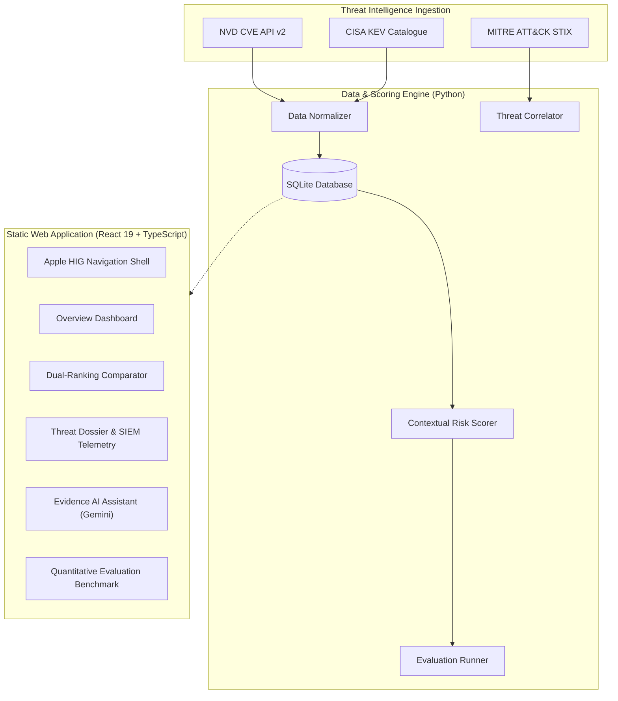

# VulnInvestigator

**Evidence-Grounded Generative AI for Vulnerability-to-Threat Investigation and Risk Prioritization**

[](https://daipayanghosal.github.io/VulnInvestigator/)
[](LICENSE)
[](https://react.dev/)
[](https://www.typescriptlang.org/)
[](https://vitejs.dev/)

VulnInvestigator is an enterprise cybersecurity intelligence platform that augments conventional CVSS-based vulnerability ranking with contextual asset criticality, CISA Known Exploited Vulnerabilities (KEV) data, and MITRE ATT&CK technique correlation. It uses Google Gemini Generative AI to formulate evidence-grounded threat investigation hypotheses with rigorous citation auditing.

---

## Live Application

The production application is deployed on GitHub Pages:  
👉 **[https://daipayanghosal.github.io/VulnInvestigator/](https://daipayanghosal.github.io/VulnInvestigator/)**

*(Legacy Streamlit visits to `vulninvestigator.streamlit.app` are automatically forwarded to this platform).*

---

## Key Features

1. **Apple Human Interface Guidelines (HIG) Design**:
   - SF Pro typography hierarchy and frosted glass header blur (`backdrop-blur-xl`).
   - macOS-style segmented pill navigation with light/dark appearance modes.
   - 100% vector-rendered interface powered by **Lucide** icons.

2. **Contextual Risk Prioritization**:
   - Replaces static CVSS severity with a multi-factor risk model:
     $$\text{Risk} = 0.35 \times \text{CVSS} + 0.30 \times \text{KEV} + 0.20 \times \text{Asset} + 0.15 \times \text{Exposure}$$
   - Quantified by Kendall's $\tau = 0.5701$ and nDCG@10 $= 0.5765$, proving substantial and disciplined queue reshuffling.

3. **Evidence-Grounded AI Threat Synthesis**:
   - Powered by Google Gemini via direct client-side REST API integration.
   - Built-in heuristic citation validator that cross-references AI claims against CVE identifiers, asset hostnames, MITRE ATT&CK techniques, and SIEM telemetry events.
   - Includes offline precomputed dossiers for zero-key evaluation.

4. **Interactive Validation Suite**:
   - Real-time Kendall's $\tau$ correlation gauge, 40-bin rank displacement histogram, and automated stress tests.

---

## Architecture Overview



---

## Getting Started

### Static Frontend Development

The frontend is built with React 19, TypeScript, and Tailwind CSS:

```bash
# Install dependencies
npm --prefix frontend install

# Start local development server
npm run dev

# Build production bundle
npm run build

# Preview production build locally
npm run preview
```

### Deploying to GitHub Pages

To compile the latest build and push directly to GitHub Pages:

```bash
npm run deploy
# or: python scripts/deploy_ghpages.py
```

---

## Python Ingestion & Evaluation Pipeline

The Python backend manages offline data ingestion, correlation, and quantitative academic benchmarks:

```bash
# 1. Setup Python environment
python -m venv .venv
source .venv/bin/activate  # On Windows: .venv\Scripts\activate
pip install -r requirements.txt

# 2. Run the evaluation pipeline across all CVE records
python scripts/run_evaluation.py

# 3. Export data artifacts to the frontend
python scripts/export_frontend_data.py
```

---

## Author

Developed by **Daipayan Ghosal**  
GitHub: [@daipayanghosal](https://github.com/daipayanghosal)  
Repository: [https://github.com/daipayanghosal/VulnInvestigator](https://github.com/daipayanghosal/VulnInvestigator)
